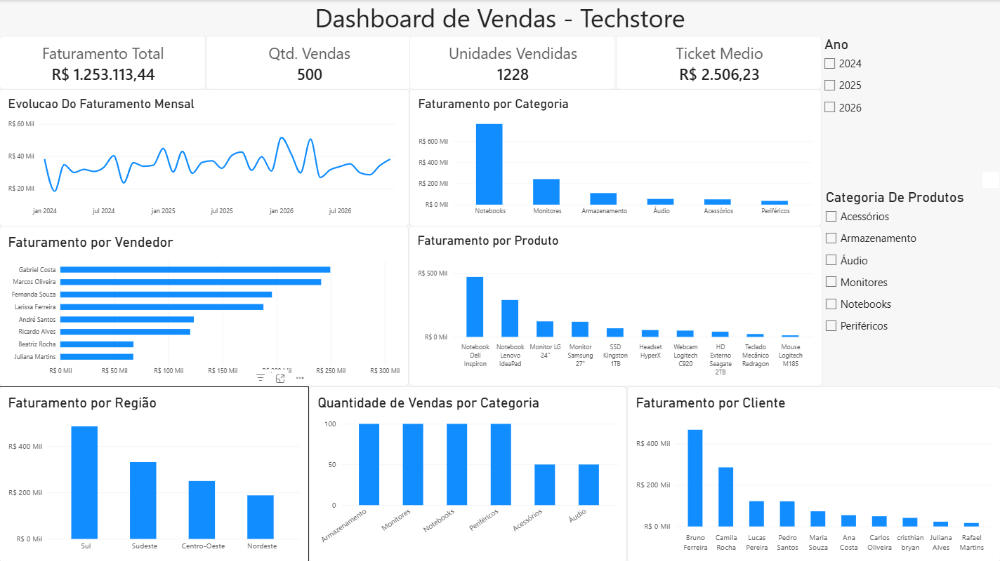
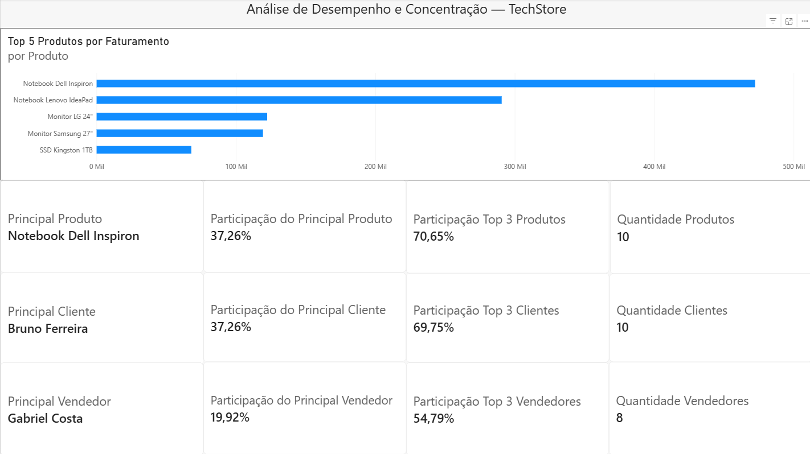
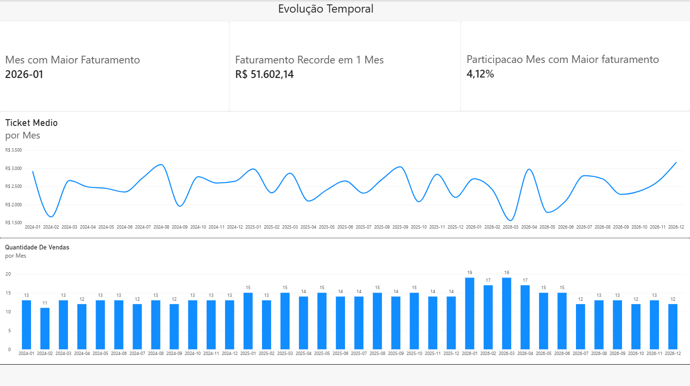

**Techstore-analise-vendas** \
Projeto de análise de vendas utilizando MySQL e Power BI, com consultas SQL, indicadores de desempenho, análise de faturamento e dashboard interativo para apoiar a tomada de decisões de negócio.

**Dashboard Power BI** \
O projeto conta com três páginas de análise, desenvolvidas no Power BI para facilitar a visualização dos indicadores e a identificação de padrões de desempenho nas vendas.

**1. Visão Geral:** \
Apresenta os principais indicadores de desempenho, incluindo faturamento total, quantidade de vendas, unidades comercializadas e ticket médio, além da distribuição do faturamento por diferentes dimensões comerciais.

**2. Análise Comercial:** \
Apresenta o desempenho e a concentração do faturamento entre produtos, clientes e vendedores, permitindo identificar os principais responsáveis pela geração de receita.

**3. Análise Temporal:** \
Apresenta a evolução do faturamento ao longo do tempo, permitindo acompanhar os resultados mensais, a quantidade de vendas e o comportamento do ticket médio.

**Principais Indicadores e Insights**

-**Indicadores Gerais**

| Indicador | Resultado |
|:--|--:|
| Faturamento total | R$ 1.253.113,44 |
| Quantidade de vendas | 500 |
| Unidades vendidas | 1.228 |
| Ticket médio | R$ 2.506,23 |

-**Principais Insights**

- **Clientes:** Bruno Ferreira liderou o faturamento individual entre os clientes, totalizando R$ 466.909 (37,25% da receita). efetuou 50 compras, somando 147 unidades comercializadas, com um elevado valor médio por unidade de R$ 3.176, 211,26% superior a média da empresa, seu ticket médio de R$ 9.338 foi aproximadamente 3,7 vezes superior ao ticket médio geral. Em comparação com a Camila Rocha 2 maior faturamento de R$ 285.209 (22,76% da receita), podemos analisar que tiveram a mesma quantidade de compras, um ticket médio por unidade bem próximo, a diferença vem nas unidades compradas, Bruno comprou 50% mais unidades por compra, com um ticket médio de 63,7% a mais que Camila. Já que efetuaram o mesmo volume de transações com um valor médio por unidade bem proximo, podemos concluir que a diferença de faturamento vem da maior quantidade de unidades por compra que elevou o valor gerado por cada transação. Os três clientes com maior faturamento representam 30% da base e geram 69,75% da receita total, indicando uma alta concentração entre os principais compradores.
  
- **Produtos:** o Notebook Dell Inspiron liderou o faturamento individual entre os produtos, totalizando R$ 472.360,00 (37,69% da receita), Seu elevado valor unitário contribuiu para esse resultado. Os três produtos com maior faturamento representam 30% da base e geram 70,75% da receita, indicando uma alta concentração entre os principais produtos.
  
- **Vendedores:** Gabriel Costa da região Centro-Oeste, liderou o faturamento individual entre os vendedores, com R$ 249.665,66 (19,92% da receita). Os três vendedores com maior faturamento representam 37,5% da base e geram 54.79% da receita, indicando uma alta concentração entre os principais vendedores.
  
- **Regiões:** 
  -  **Sul** liderou o faturamento, com R$ 484.784,84 (38,69% da receita total). Registrou 188 vendas, a mesma quantidade do Sudeste, mas comercializou 492 unidades, uma média de unidades por venda 6,55% superior à média da empresa. Apesar de apresentar o menor valor médio por unidade vendida, 3,44% abaixo da média, teve um ticket médio de R$ 2.578, 2,87% superior ao da empresa. Esse resultado indica que o maior volume de unidades comercializadas por transação compensou o menor valor médio por unidade, contribuindo para o maior faturamento da região.

  -  **Sudeste** ficou em segundo lugar, com R$ 330.826,10 (26,40% da receita). Apesar de registrar as mesmas 188 vendas do Sul, comercializou 312 unidades, com uma média de unidades por venda 32% inferior a da empresa. Mesmo apresentando o maior valor médio por unidade vendida, 3,90% acima da media, teve o menor ticket médio entre as regiões, de R$ 1.758, 29,84% abaixo do ticket médio da empresa. Isso demonstra que o menor volume de unidades por transação não foi compensado pelo maior valor médio dos produtos, resultando em um ticket médio inferior e contribuindo para a diferença de faturamento em relação ao Sul.
  
  -  **Centro-Oeste** ocupa a terceira posição, com R$ 249.665 (19,92% da receita), registrou apenas 62 vendas, consideravelmente inferior ao do Sul e Sudeste, mas comercializou 242 unidades, alcançando a maior média de        unidades por venda entre as regiões, 58% superior a da empresa. Também apresentou o maior ticket médio, de R$ 4.026, 60,65% acima da media da empresa. Esses resultados indicam que o elevado volume de unidades por          transação contribuiu para o maior ticket médio, mas a quantidade reduzida de vendas limitou o faturamento da região.
  
  - **Nordeste** apresentou o menor faturamento, de R$ 187.836 (14,98% da receita), registrou 62 vendas e comercializou 182 unidades, o menor volume entre as regiões. Apesar disso, apresentou uma média de unidades por venda 19,50% superior a media da empresa e um ticket médio de R$ 3.023, 20,62% acima da média. mesmo com um ticket médio superior ao da empresa, o baixo número de transações limitou seu faturamento. Na comparação com o Centro Oeste, que registrou a mesma quantidade de vendas, o Nordeste comercializou 60 unidades a menos e apresentou um ticket médio inferior, contribuindo para a diferença de faturamento entre as regiões.
  
- **Categoria de destaque:** A categoria de Notebooks liderou o faturamento, totalizando R$ 762.920,00 (60,88% da receita). Essa concentração pode ser explicada pelo maior valor unitário dos produtos dessa categoria, indicando que produtos de maior valor têm forte influência sobre o resultado financeiro da empresa.
  
- **Desempenho temporal:** janeiro de 2026 registrou o maior faturamento mensal, com R$ 51.602,14 (4,11% da receita). O resultado foi favorecido pela combinação de um elevado volume de vendas e um ticket médio relativamente alto. Embora março de 2026 tenha apresentado uma quantidade de vendas semelhante, seu ticket médio esteve entre os menores do período, contribuindo para um faturamento inferior.

Os resultados evidenciam uma concentração significativa do faturamento nos principais clientes, produtos e vendedores, permitindo identificar os grupos que mais contribuem para o desempenho comercial.

**Observação:** os dados utilizados neste projeto são fictícios e foram criados para fins de estudo e demonstração de habilidades em análise de dados.
